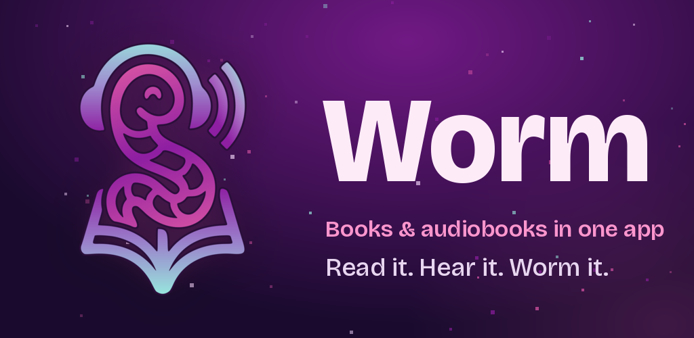

<p align="center"></p>

<p align="center">
  <a href="LICENSE"></a>
  
</p>

Worm is a free, open-source Android app for your own ebooks and audiobooks. It reads them where they
already live on your phone, keeps your place in both, and plays nicely with your car, your e-reader,
your other devices and other reading apps. No accounts, no ads, no tracking.

## Features

**Library**
- Point Worm at the folders you already use. Multi-file audiobooks, series and authors are grouped for you.
- Shelves, filters (books / audiobooks), sorting and grouping by author, series, narrator or folder; search everything.
- Fix titles, authors, series and covers by hand or with *magic match* (Open Library, Google Books, Apple Books, Audible).
- **The Burrow**: a PIN/biometric-locked private shelf, hidden everywhere until you open it.
- Back up all your library tidying (edits, covers, shelves, positions, bookmarks) to one file.

**Reading** (EPUB, MOBI, AZW3, FB2, CBZ, TXT…)
- Themes, fonts (Literata, Lora, EB Garamond, Atkinson Hyperlegible), sizes, margins, spacing, per-book looks.
- Paged or scrolling, two pages side by side on wide screens, tap / swipe / volume-key / gamepad page turns.
- Highlights, notes, bookmarks, search, footer with progress, clock and battery.
- Define: offline StarDict dictionaries, Wiktionary and Wikipedia.
- Speed reading: one word at a time, at the pace you choose.

**Listening** (M4B, MP3, M4A, OGG, OPUS, FLAC…)
- Chapters (embedded or matched online), speed, sleep timer with fade-out and shake-to-extend, smart rewind after pauses, bookmarks.
- Android Auto, Bluetooth, lock screen and a notification with your own skip lengths.

**Making and moving books**
- **Silk Spinner**: turn a folder of MP3s into a single chaptered M4B, on the phone.
- **Metamorphosis**: turn TXT, Markdown, DOCX, HTML, FB2, MOBI, AZW3 and CBZ into EPUB.
- **Wormhole**: send books, audiobooks and (if you choose) your reading spot to another Worm or any browser on the same Wi-Fi. The receiver accepts or declines.
- Built-in browser, download manager, OPDS catalogs and a torrent client, for books you're allowed to download.

**Sync and more**
- KOReader sync (KOSync) and Readest cloud sync, including uploading books to your Readest cloud.
- Worm's-eye view: what's in your library, time read and listened, books finished.
- Home screen widgets: keep reading, keep listening, now playing, this week and this month.
- Six themes, including **E-ink** (black on white, no animation; page buttons scroll the library).
- Fully usable with a D-pad or game controller.

## Install

Download the APK from the [Releases](https://github.com/amruthwo/Worm/releases) page. Most phones
want the `arm64-v8a` APK; older 32-bit phones want `armeabi-v7a`.

Worm isn't on Google Play. To see it in Android Auto, open Android Auto's settings, tap *Version*
ten times, then in the ⋮ menu choose *Developer settings* and turn on *Unknown sources*.

## Permissions and privacy

| Permission | Why |
|---|---|
| All files access | Read books from the folders you choose; write converted books and downloads beside them. |
| Notifications | Playback controls and progress for conversions, downloads and transfers. |
| Foreground service | Keep audio, conversions and downloads running when the screen is off. |
| Internet | Book details and covers, sync, catalogs, the browser and downloads. Only when you use them. |
| Camera | Scan another device's Wormhole QR code. Optional. |
| Nearby Wi-Fi devices | Find other Worms and start a private hotspot for the Wormhole. Optional. |

Worm has no analytics and no ads. It only talks to a service when you use a feature that needs it
(for example looking up a cover, syncing with KOReader/Readest, or defining a word online).

## Build

Requirements: JDK 21 and the Android SDK (compile SDK 37).

```sh
./gradlew assembleDebug
```

APKs land in `app/build/outputs/apk/debug/`, one per ABI. To sign builds with your own key,
create `keystore.properties` in the project root (it's git-ignored):

```properties
storeFile=keystore/your.jks
storePassword=…
keyAlias=…
keyPassword=…
```

or set `WORM_KEYSTORE_FILE`, `WORM_KEYSTORE_PASSWORD`, `WORM_KEY_ALIAS` and `WORM_KEY_PASSWORD`.
Without either, builds are unsigned.

## Development

Kotlin, Jetpack Compose and Material 3 Expressive.

- `data/`: library scanning, metadata, progress, shelves, the Burrow, backups.
- `reader/` + `assets/reader/`: the reader, built on foliate-js in a WebView.
- `player/`: Media3 playback service (notification, Android Auto).
- `convert/`: Silk Spinner and Metamorphosis.
- `sync/`: KOSync and Readest.
- `wormhole/`: device-to-device sharing.
- `download/`, `opds/`, `torrent/`: getting books.
- `widget/`: home screen widgets (Glance).
- `ui/`: screens, themes and the Bookworm easter egg.

Bug reports and ideas are welcome in [Issues](https://github.com/amruthwo/Worm/issues).

## Credits

- [foliate-js](https://github.com/johnfactotum/foliate-js) (MIT): ebook rendering.
- [AndroidX Media3](https://github.com/androidx/media) (Apache-2.0): playback, Android Auto, conversion.
- [libtorrent4j](https://github.com/aldenml/libtorrent4j) (MIT) / libtorrent (BSD): torrents.
- [NanoHTTPD](https://github.com/NanoHttpd/nanohttpd) (BSD): Wormhole server.
- [ZXing](https://github.com/zxing/zxing) (Apache-2.0): QR codes.
- [Coil](https://github.com/coil-kt/coil) (Apache-2.0): images.
- Fonts: Literata, Lora, EB Garamond, Atkinson Hyperlegible and Bricolage Grotesque (SIL Open Font License).
- Material icons (Apache-2.0).

Worm talks to, but isn't affiliated with, KOReader, Readest, Open Library, Google Books, Apple Books,
Audible/Audnexus, Wiktionary and Wikipedia.

## License

Worm is free software under the [GNU General Public License v3.0 or later](LICENSE).
